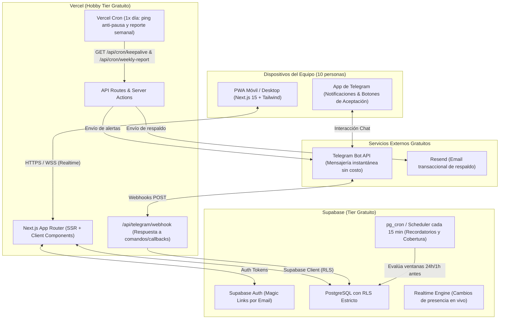

# Fase 0: Arquitectura, Esquema de Datos y Plan de Recursos

Este documento consolida la arquitectura técnica, modelo de datos relacional con RLS, variables de entorno y análisis de cuotas gratuitas para la **App de Coordinación de Presencia (Regla de 2 & Carpooling)**.

---

## 1. Diagrama de Arquitectura de la Solución

---

## 2. Decisión Técnica: Programación de Tareas Automáticas (Scheduling)

### Limitación de Vercel Hobby
- Vercel Hobby solo permite cron jobs **1 vez al día** y con horario impreciso.
- **Uso asignado a Vercel Cron:**
  1. Ping diario (`/api/cron/keepalive` a medianoche UTC) para evitar que Supabase congele el proyecto por 7 días de inactividad.
  2. Generación del reporte semanal para el admin (`/api/cron/weekly-report` los domingos).

### Elección para tareas frecuentes (cada 15 minutos)
- **Opción elegida:** **`cron-job.org` (o `pg_cron` de Supabase)** invocando un endpoint protegido `/api/cron/presence-reminders` con cabecera `Authorization: Bearer <CRON_SECRET>`.
- **Razón técnica:** `cron-job.org` es 100% gratuito, ofrece reintentos automáticos, métricas visuales de latencia y no depende de compilar extensiones adicionales en bases de datos con recursos restringidos. Para entornos donde se prefiera todo integrado, dejamos listo el script SQL para habilitar `pg_cron` + `pg_net`.

---

## 3. Estimación de Consumo en Capa Gratuita (Equipo de 10 personas)

| Servicio | Límite Gratuito Mensual | Consumo Estimado (10 usuarios) | % del Límite |
| :--- | :--- | :--- | :--- |
| **Vercel Hobby** | 100 GB ancho de banda / 100,000 Edge invocations | ~1.5 GB / ~15,000 peticiones | **< 2%** |
| **Supabase Database** | 500 MB almacenamiento | ~25 MB tras 1 año de datos | **< 5%** |
| **Supabase Auth** | 50,000 usuarios activos mensuales (MAU) | 10 usuarios | **0.02%** |
| **Telegram Bot API** | Ilimitado (sin coste comercial) | ~400 mensajes al mes | **0% (Gratis)** |
| **Resend** | 3,000 correos al mes (100 diarios) | ~50 correos al mes (solo respaldo/magic link) | **< 2%** |

> **Conclusión:** La solución se mantendrá permanentemente dentro de las cuotas 100% gratuitas sin riesgo de cobros sorpresivos.

---

## 4. Supuestos y Decisiones Iniciales

1. **Horario de Operación del Lugar:** Por defecto fijado de `07:00` a `23:00`. Fuera de ese rango no se generan penalizaciones ni alertas de cobertura solitaria (configurable en `app_settings`).
2. **Rol del Admin en la Regla de 2:** El admin cuenta como una persona activa si declara una ventana de presencia (`admin_counts_for_coverage = true`).
3. **Registro Cerrado:** Únicamente usuarios previamente invitados por el admin pueden iniciar sesión con enlace mágico (Magic Link) de Supabase Auth.
4. **Protección del Registro de Auditoría (`audit_log`):** Solo visible para usuarios con rol `admin` mediante políticas de RLS a nivel de base de datos Postgres.
